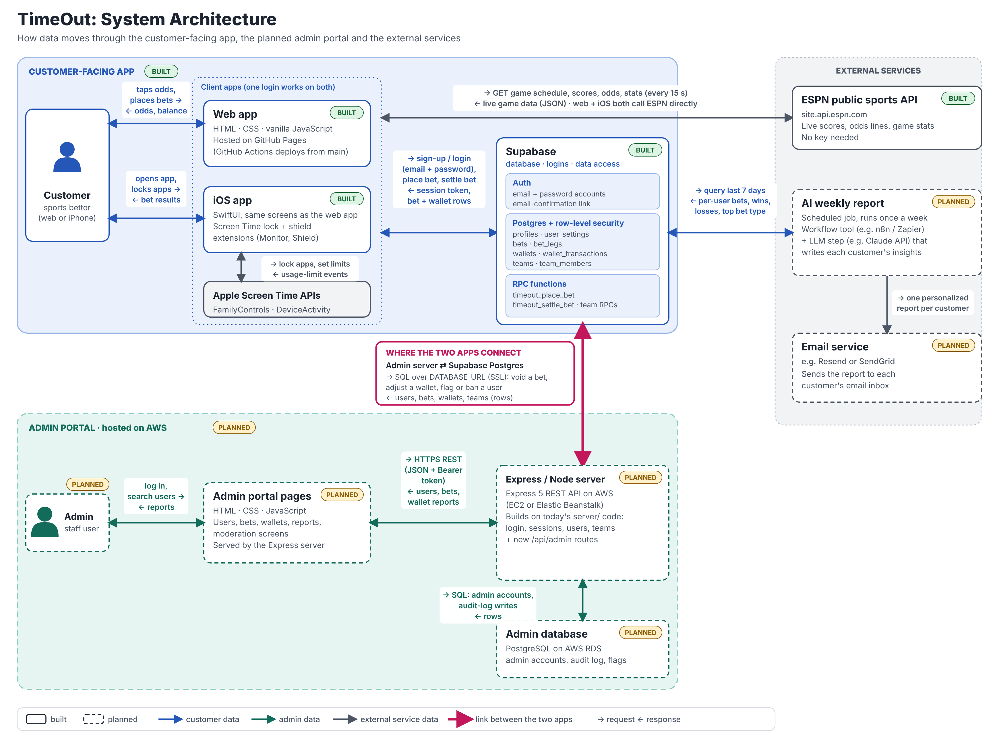

# TimeOut

**The sportsbook where you bet screen time instead of money.**
Group 9, Section 1: Owen Smith, Easton Putnam, Will Fairholm, Marcus Williams.

> **▶ Try the app:** <https://marcustheman13.github.io/TimeOut/> (resizes to fit phones, tablets and computers)
> Live ESPN odds and real accounts, nothing to install. It updates by itself when the web demo changes on `main`.
>
> **🔑 Test login** (website and iPhone app): email `marcusdanielwill@gmail.com` · password `test_account_pass` (username `@time_out_account`).

---

## App Summary

Sports betting has exploded, and the apps behind it are built to keep people chasing losses with real money.
Our interviews showed that most bettors aren't in it for the cash. They bet because it makes watching the game more exciting and gives them something to talk about with friends.
TimeOut keeps that excitement and removes the financial risk: instead of money, users bet with their phone's screen time.
Everyone gets 60 betting minutes a day. Win a bet and tomorrow's phone time goes up; lose and it goes down, so the stakes are real but nobody loses money.
The app has live scores and odds, automatic bet settlement, a running win/loss record, and bets with friends where the stake is something like "loser does the dishes."
It's aimed at casual and at-risk sports bettors (the "Addicted Adam" persona from our research) who want the thrill of betting without the damage, and it can even cut down how much time they spend on their phones.

Full requirements: [docs/PRD - Prioritization & Design Sprint.pdf](docs/PRD%20-%20Prioritization%20%26%20Design%20Sprint.pdf)

---

## System Architecture

How data moves through the customer-facing app, the planned admin portal and the external services. Solid boxes are built today, dashed boxes are planned.



---

ORIGINAL ERD


DATABASE INTEGRATED ERD


Tables that already exist (used by the login vertical slice):

Table	Purpose	Key columns
users	One row per account	user_id PK, username (unique), email (unique), password_hash, photo_url, created_at, last_login_at, login_count
sessions	One row per logged-in device	session_id PK, user_id FK → users, token_hash, device_label, created_at, expires_at
users → sessions is one-to-many (one user can be logged in on several devices).

---

## Tech Stack

The [architecture diagram](#system-architecture) shows how these pieces connect.

| Layer | What we use | Where it lives |
| --- | --- | --- |
| Web app | Plain HTML, CSS and JavaScript, no framework. Hosted on GitHub Pages and deployed by GitHub Actions from `main` | [`TimeOut - Web/`](TimeOut%20-%20Web), [`pages.yml`](.github/workflows/pages.yml) |
| iOS app | Native SwiftUI app with the same screens and features as the web app, plus real Screen Time blocking (FamilyControls, DeviceActivity) through Monitor and Shield extensions | [`TimeOut - iOS App/`](TimeOut%20-%20iOS%20App) |
| Database | Supabase Postgres with row-level security. Bets and wallet changes go through RPC functions such as `timeout_place_bet` and `timeout_settle_bet` | [`js/api.js`](TimeOut%20-%20Web/js/api.js), [`API.swift`](TimeOut%20-%20iOS%20App/TimeOut/Services/API.swift), `server/db/supabase-*.sql` |
| Auth | Supabase Auth: email + password accounts with an email-confirmation link. One login works on both apps | [`js/api.js`](TimeOut%20-%20Web/js/api.js), [`API.swift`](TimeOut%20-%20iOS%20App/TimeOut/Services/API.swift) |
| Live sports data | ESPN's public API (no key needed), called directly by each app | [`js/live.js`](TimeOut%20-%20Web/js/live.js), [`LiveFeed.swift`](TimeOut%20-%20iOS%20App/TimeOut/Engine/LiveFeed.swift) |
| Local dev server | Node.js + Express 5. Serves the web app at `localhost:3000` and handles teams and user search while it's running. Uses embedded PostgreSQL ([PGlite](https://pglite.dev)) unless `DATABASE_URL` is set. The live site doesn't use it | [`server/src/`](server/src) |

**Why this fits our team.** Blocking apps uses Apple's Screen Time APIs, which only work in a real iOS app, so we need a native iPhone app next to the web app.
Supabase gives both apps the same accounts, tables and RPC functions without us running a server, so a bet placed on the website shows up on the phone.
Rules like "you can't stake more minutes than you have" live in those RPC functions, where users can't edit them.
The web app is static files, so GitHub Pages can host it, and row-level security is what makes it safe for the Supabase publishable key to sit in browser code.

---

## How to Get It Running

**Just want to try it?** Open the live site, no setup needed: <https://marcustheman13.github.io/TimeOut/>. It resizes to fit any screen. It's the real app with live odds and Supabase accounts, and it redeploys whenever the web demo changes on `main`. The steps below are for running and changing the code yourself.

**You need:** [Node.js](https://nodejs.org) 20 or newer (`node -v` to check) and Git. Nothing else, not even PostgreSQL.

1. **Get the code**
   ```bash
   git clone https://github.com/Marcustheman13/TimeOut.git
   ```
   ```bash
   cd TimeOut/server
   ```
2. **Install the server's packages**
   ```bash
   npm install
   ```
3. **(Optional) Point at the shared team database.** Skip this to use your own local database.
   Copy the example env file, then paste the connection string a teammate sends you (never in the group chat or GitHub) after `DATABASE_URL=`.
   ```bash
   cp .env.example .env
   ```
4. **Start it**
   ```bash
   npm start
   ```
   You should see `TimeOut is running at http://localhost:3000`. The first run creates the tables and sample data automatically.
5. **Open the app:** <http://localhost:3000>. On a laptop it shows a phone with a tester console beside it.
   For the full-window browser version, open <http://localhost:3000/web>.

**Test accounts** (from `server/db/seed.sql`, all use the password `timeout123`): `demo`, `mike_t`, `jess.plays`, `lily_k`.
Or press **Create account** to make your own.

**Useful commands** (run inside `server/`):

| Command | What it does |
| --- | --- |
| `npm start` | Runs the API + web demo on port 3000 |
| `npm run dev` | Same, but restarts when you edit a server file |
| `npm run db:reset` | Deletes all data and rebuilds the tables from `db/schema.sql` + `db/seed.sql` |
| `npm run db:query` | Prints the `users` table. Add your own SQL: `npm run db:query -- "SELECT * FROM sessions"` |

The embedded database can only be open in one program at a time, so stop the server (Ctrl+C) before `db:reset` or `db:query`.
On a shared Supabase or Neon database you can run them while the server is up, or use the table editor in their dashboard.

**Shared database setup (one person, once):** create a free project at [supabase.com](https://supabase.com) or [neon.tech](https://neon.tech), copy its Postgres connection string
(Supabase: *Connect > Session pooler > URI*), put it in your `server/.env` as `DATABASE_URL=...`, run `npm run db:reset`, then send the string to teammates privately.

**No server?** You can still double-click `TimeOut - Web/index.html` (or `dist/TimeOut.html`). It runs in offline demo mode with accounts saved only in that browser.

---

## Verifying the Vertical Slice

**The slice: logging in.** When you press **Log in**, the app:

1. sends `POST /api/auth/login` with your username/email and password ([`js/api.js`](TimeOut%20-%20Web/js/api.js)),
2. checks the password against the bcrypt hash, then **updates** your row in `users` (`last_login_at = now()`, `login_count = login_count + 1`) and inserts a row in `sessions` ([`server/src/auth.js`](server/src/auth.js)),
3. returns the updated user (including the new `loginCount` and `lastLoginAt`) to the browser,
4. shows it in the UI: a toast saying **"Login #N, saved to the database"** and, under **Menu (☰) > Account**, a **"Saved in the TimeOut database"** card with *Last login* and *Total logins*.

**Try it:**

1. `npm start`, open <http://localhost:3000>, press **Log in**.
2. Enter `demo` / `timeout123` and press **Log in**. Note the login number in the toast (the seed data starts `demo` at 12, so your first login is #13).
3. Open **Menu (☰) > Account**. *Total logins* and *Last login* match the toast.
4. **Refresh the page.** You stay logged in, and *Total logins* and *Last login* are unchanged. The page re-reads them from the database with `GET /api/auth/me` on every load.
5. Log out and log in again. *Total logins* goes up by one.
6. To see it in the database itself: stop the server and run `npm run db:query`. The `demo` row has the same `login_count` and `last_login_at`.

Error cases to try: a wrong password shows *"That password is incorrect."*; an unknown username shows *"No account matches that username or email."*; signing up with a taken username or email marks that field.

---

## Repo Layout

```
TimeOut/
├── README.md                    ← you are here
├── docs/                        ← PRD, ERD image, architecture diagram
├── server/                      ← Express API + database
│   ├── src/index.js             ← starts the server, serves the web demo, mounts /api routes
│   ├── src/auth.js              ← /api/auth/register, /login, /me, /logout
│   ├── src/db.js                ← connects to Postgres (DATABASE_URL) or the embedded database
│   ├── db/schema.sql            ← CREATE TABLE statements (add the ERD tables here)
│   ├── db/seed.sql              ← sample rows for every table
│   ├── scripts/                 ← db:reset and db:query
│   └── .env.example             ← copy to .env (which git ignores)
├── TimeOut - Web/               ← the clickable web app (HTML/CSS/JS)
│   ├── index.html               ← the web app; resizes from phone to desktop
│   ├── css/web.css, js/web.js   ← its responsive layout (web.html just forwards old links)
│   ├── js/api.js                ← every call from the web app to the server goes through here
│   └── README.md                ← what each screen does and the tester console
└── TimeOut - iOS App/           ← SwiftUI iOS app (open TimeOut.xcodeproj in Xcode)
```

## API

All requests and responses are JSON. Errors look like `{ "error": { "code", "message", "fields" } }`, where `fields` maps an input name to its error message.

| Method & path | Body | Returns |
| --- | --- | --- |
| `GET /api/health` | | `{ ok, database }` |
| `POST /api/auth/register` | `{ username, email, password, photoUrl? }` | `201 { token, user }` |
| `POST /api/auth/login` | `{ identifier, password }` (identifier = username or email) | `{ token, user, previousLoginAt }` |
| `GET /api/auth/me` | header `Authorization: Bearer <token>` | `{ user }` |
| `POST /api/auth/logout` | header `Authorization: Bearer <token>` | `204` |

`user` = `{ id, username, email, photoUrl, isDemo, createdAt, lastLoginAt, loginCount }`.

## Working Together

- **Don't commit to `main` directly.** Make a branch, push it, open a pull request, and have one teammate look at it before merging:
  ```bash
  git switch -c your-name/what-you-are-doing
  ```
- Pull before you start each time so you build on everyone's latest work:
  ```bash
  git pull origin main
  ```
- **Never commit `server/.env`** or paste the database connection string into code, issues or chat. `.gitignore` already blocks `.env`.
- If you change `schema.sql`, also update `seed.sql` and the ERD, and tell the team to run `npm run db:reset`.
- After editing anything in `TimeOut - Web/css` or `js`, run `python3 build.py` in that folder if you want the single-file `dist/TimeOut.html` updated.

## What's Still Stored Only in the Browser

Accounts, game bets, the screen-time wallet, settings and teams are saved in Supabase. Friends, friend requests, clean-day history, and race, prediction and to-do bets are still saved only on the device (`localStorage` on the web, [`js/state.js`](TimeOut%20-%20Web/js/state.js)).
To move a feature over: add its tables and RPC functions in Supabase, add a function in `js/api.js` and `API.swift`, and call it from the screen.
Good next slice: sending a friend request.
