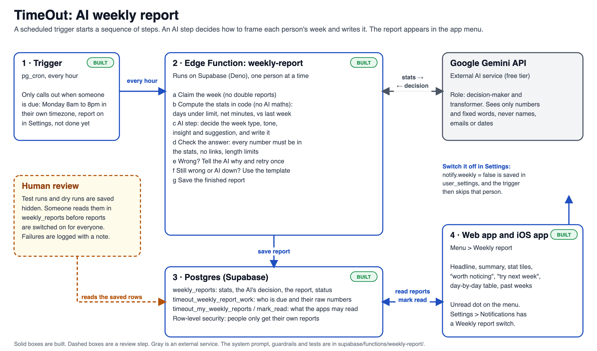

# Weekly report

Every Monday morning (8am in the person's own timezone) TimeOut writes each active user a short review of their week and puts it in the app, under **Menu > Weekly report** on both the iPhone app and the website. It shows their challenge record, net minutes and, once their phone has synced screen-time records, how they did against their limits. An AI step decides how to frame the week and writes the words. Code does all the arithmetic.



## How it works

```
pg_cron (hourly) ─► timeout_ping_weekly_report()      only calls out if somebody is due
                        │
                        ▼
              weekly-report Edge Function
   1. timeout_weekly_report_work   raw numbers for everyone due (SQL)
   2. claim                        one run per person per week (weekly_reports row)
   3. stats.ts                     all the arithmetic: days under limit, net minutes, vs last week
   4. ai.ts  (Gemini)              DECIDES the week type, tone, insight and suggestion, and writes the text
   5. decision.ts                  checks the AI's answer; falls back to a template if it fails
   6. report.ts                    builds the report the apps draw (words, tiles, day-by-day table)
   7. finish                       saves it in weekly_reports as published (or hidden, for a dry run)
                        │
                        ▼
   apps call timeout_my_weekly_reports  ─►  menu item + unread dot  ─►  Weekly report page
```

**What the AI decides** (as JSON, not free text): `weekType` (crushed, steady, slipped or risky), `tone`, the one `insight` worth noticing, a `suggestion` with a kind, and `skip` when the week is too thin to report.

**What stops it going wrong** (`decision.ts`)

- Every number the AI writes must appear in the stats it was given. An invented number means the template writes that report instead.
- It can't call a losing week or an over-limit week "crushed".
- No links or markup, and length limits on every field.
- If an answer breaks a rule, the AI is told which one and gets **one retry**. A failed call (rate limit, outage) waits 4 seconds and retries once too.
- If that still fails, or Gemini has no key, the template writes the report. It is still published, and `weekly_reports.source` / `note` say why.
- The AI only ever sees numbers and fixed words. Never a name, email, date or any text a user typed. The function never even receives the person's name or email.
- Reports stay **hidden** (dry runs) until you turn them on (see step 6). Until then you can read each one in the table first. That is the human review step.

**Who gets one.** Anyone with a row in `user_settings` whose Settings > Notifications > Weekly report switch is on (the default), who had at least one resolved challenge or recorded screen time that week. A quiet week produces no report.

**Data it uses.** Challenges come from `challenges` and `challenge_picks`. Screen-time usage comes from `user_settings.shared_ledger`, which the iPhone app writes. If that is empty, the report covers challenges only and leaves out anything about screen time.

**Where people see it, and how they're told.**

- **Home:** a "Weekly report" card sits under the tier strip all week, showing the latest headline. When the next report is published, the card switches to it (and the older one moves to "Other weeks" on the report page).
- **Menu > Weekly report:** the full report, with a "New" tag and an unread dot on the menu until it is opened.
- **A "Your weekly report is ready" alert, once per new report.** On the website and in the iPhone app it is a banner while the app is open (the apps check for a new report every few minutes). On the iPhone, a normal notification is also sent when iOS wakes the app in the background, which is how a person who never opens TimeOut still hears about it. Turning the report off in Settings stops the alert.

**What the apps can read.** Only `timeout_my_weekly_reports` (the signed-in person's own published reports) and `timeout_mark_weekly_report_read`. The table itself has row-level security with no policies, so nobody can read it directly.

## Setup

Nothing here has been deployed yet. Do these in order. There is no email service, so no domain and no Resend account.

### 1. Get a free Gemini key

Create an API key in [Google AI Studio](https://aistudio.google.com/apikey). The free tier needs no card. The default model is `gemini-flash-lite-latest`, an alias Google keeps pointed at its current small model. (Named versions get retired: `gemini-2.5-flash` already stopped working for new keys.) Set `GEMINI_MODEL` to use another one.

### 2. Check the AI works (no database or deploy needed)

Put the key where only you can see it. Either `export GEMINI_API_KEY=...` in your terminal, or put the line `GEMINI_API_KEY=...` in `supabase/functions/weekly-report/.env` (git ignores it). Then:

```bash
deno run --allow-net --allow-env --allow-read --allow-write supabase/functions/weekly-report/live_check.ts --runs=3 --json=sample-report.json
```

It confirms the model name exists, then sends four sample weeks (a strong week, a rough week with no screen-time records, a risky week, a thin week) through the same code the Edge Function uses, three times each. For every run it says whether **the AI's own words were used** or the template stepped in, and why. `sample-report.json` is the first report, in the form the apps receive it.

### 3. Update the database

In the Supabase SQL Editor for project `obegznrsxlbpmtbmqkll`, run `server/db/supabase-weekly-report.sql`. It turns on `pg_cron` and `pg_net` itself, and it is safe to rerun.

The hourly ping reads the Vault secret `push_webhook_secret` and does nothing until it exists. If you haven't made it yet (`select name from vault.secrets;` shows whether), make one and keep the value, since step 4 needs the same one:

```sql
select vault.create_secret('A_LONG_RANDOM_VALUE', 'push_webhook_secret');
```

(`openssl rand -hex 32` makes a good value.)

### 4. Deploy the function

From the repository root. `--no-verify-jwt` is needed because the database calls the function with `x-push-secret`, not a user's login. The function checks that secret itself.

```bash
npx supabase secrets set --project-ref obegznrsxlbpmtbmqkll GEMINI_API_KEY=THE_GEMINI_KEY PUSH_WEBHOOK_SECRET=THE_SAME_VALUE_AS_THE_VAULT_SECRET
```

```bash
npx supabase functions deploy weekly-report --project-ref obegznrsxlbpmtbmqkll --no-verify-jwt
```

| Secret | Needed | What it does |
| --- | --- | --- |
| `GEMINI_API_KEY` | Yes for AI | Without it, every report is written by the template. |
| `PUSH_WEBHOOK_SECRET` | Yes | Must match the Vault secret. |
| `GEMINI_MODEL` | No | Defaults to `gemini-flash-lite-latest`. |
| `WEEKLY_REPORT_DRY_RUN` | No | Reports stay hidden until this is `false`. |

### 5. Try it on one person, any day of the week

Find a user id in Supabase (Authentication > Users), then ask for a report. A single-person run is hidden (a dry run) unless you say otherwise, and it ignores the Monday schedule.

```bash
curl -X POST https://obegznrsxlbpmtbmqkll.supabase.co/functions/v1/weekly-report -H "x-push-secret: THE_SECRET" -H "content-type: application/json" -d '{"userId":"THE_USER_ID"}'
```

Read what it wrote:

```sql
select status, source, note, report, decision, stats
from weekly_reports order by created_at desc limit 5;
```

When it looks right, publish one to your own account to see it in the app: add `"dryRun":false` to the request above, using your own user id. It then shows up under Menu > Weekly report. To test a different week, add `"weekStart":"2026-11-02"` (a Monday).

### 6. Turn it on

`npx supabase secrets set --project-ref obegznrsxlbpmtbmqkll WEEKLY_REPORT_DRY_RUN=false`. The cron job is already scheduled by the SQL file. It does nothing outside Monday 8am to 8pm local time.

Dry-run rows count as handled for that week, so a user won't get a report for a week you only dry-ran. To release one: `delete from weekly_reports where user_id = '…' and week_start = '…';`

## Tests

```bash
deno test supabase/functions/weekly-report/
```

Covers the stats arithmetic, the checks on the AI's answer, the retry and fallback, the report builder, and the Gemini request. They need no network and no keys. They can't tell you whether the real Gemini behaves, which is what `live_check.ts` (step 2) is for.

## Known limits

- **Screen-time usage is empty today.** `shared_ledger` holds no usage for any account yet, so reports are challenge-only until the iPhone app syncs it. The first synced week switches the usage sections on by itself.
- **Timezones.** The website saves the browser's timezone, but the iPhone app doesn't yet, so a user who only uses the iPhone app keeps the default (`America/Denver`) and gets their report at 8am Denver time.
- **The alert is not a real push notification.** The iPhone only learns about a new report when the app is open or when iOS wakes it in the background, which can take an hour or more and isn't guaranteed. A server push ("Your weekly report is ready" the moment it is published) could reuse the existing push system once that is live. The website can only alert while it is open.
- **Gemini's free tier is rate limited.** People are processed one at a time, 20 per hourly run. A rate-limited call just uses the template for that person.
- **Limits are estimated.** The server rebuilds each day's limit the way the app does (60, plus yesterday's results, minus penalties, plus emergency unlocks), so a day near its limit could differ slightly from what the app showed.
- **The iPhone screen was compiled but not run.** The simulator can't install the app because of its Screen Time extension, so check Menu > Weekly report on a real iPhone.
